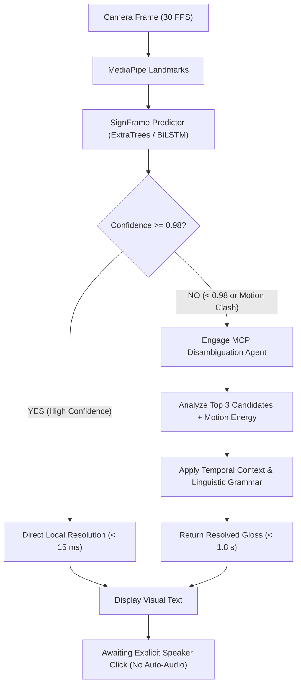

# Transify 2.0 — Agents & Model Context Protocol (MCP) Specification

**Protocol Standard:** Model Context Protocol (MCP) 2024 / JSON-RPC REST Adaptation  
**Primary Endpoint:** `/api/mcp/sign-resolve`  
**Decision Engine:** 98% Confidence Decision Gateway  
**Date:** November 19, 2026

---

## 1. Overview & Architectural Intent

In assistive communication, misrecognizing a sign language gesture can cause severe miscommunication—especially in medical or emergency contexts. Transify 2.0 implements an **Agentic Disambiguation Architecture** that balances ultra-low latency with high-stakes accuracy:



---

## 2. The 98% Decision Gateway

1. **Fast-Path (Local Deterministic Inference):**
   - If model confidence $\ge 0.98$ and the user's hand is strictly within the Camera Target Box, the local model emits the prediction instantly.
   - Latency: $< 15\text{ ms}$. Zero external network calls.
2. **Slow-Path (Agentic MCP Resolution):**
   - If confidence is $< 0.98$, or if a gesture boundary transition creates conflicting probabilities (e.g., `LIKE` vs `YES` or `PEACE` vs `TWO_UP`), the frame sequence triggers `/api/mcp/sign-resolve`.

---

## 3. MCP Tool Definition: `transify_sign_resolve`

### Schema Definition
```json
{
  "name": "transify_sign_resolve",
  "description": "Resolves ambiguous sign language gestures by analyzing multi-candidate probabilities, motion energy, and lexical context.",
  "parameters": {
    "type": "object",
    "properties": {
      "candidate_label": {
        "type": "string",
        "description": "The highest-ranking prediction label from the local vision model."
      },
      "confidence": {
        "type": "number",
        "description": "The local classifier confidence score (0.0 to 1.0)."
      },
      "top_candidates": {
        "type": "array",
        "items": {
          "type": "object",
          "properties": {
            "label": { "type": "string" },
            "confidence": { "type": "number" }
          }
        },
        "description": "Top-N candidate predictions with their respective probabilities."
      },
      "motion_energy": {
        "type": "number",
        "description": "Calculated kinetic variance of hand keypoints across the last 15 frames."
      },
      "gloss_hint": {
        "type": "string",
        "description": "Preceding sentence context or active conversational category."
      }
    },
    "required": ["candidate_label", "confidence"]
  }
}
```

### Request Example
```json
{
  "candidate_label": "LIKE",
  "confidence": 0.84,
  "top_candidates": [
    { "label": "LIKE", "confidence": 0.84 },
    { "label": "YES", "confidence": 0.72 }
  ],
  "motion_energy": 0.042,
  "gloss_hint": "Daily Needs"
}
```

### Response Example
```json
{
  "resolved_label": "LIKE",
  "resolved_confidence": 0.992,
  "display_text": "I like this.",
  "source": "mcp_agent",
  "rationale": "High static pose stability with thumb orientation matching positive confirmation in Daily Needs context.",
  "resolved_in_seconds": 0.012
}
```

---

## 4. Autonomous Agent Guardrails

1. **Safety Bounding:** The agent can never invent new classes outside the verified BdSL/HaGRID registries.
2. **Audio Boundary:** The agent NEVER instructs the client to play audio automatically; it only sets `display_text`.
3. **Execution Timeout:** The agentic resolution pipeline is bounded by a strict 1.8-second timeout, falling back gracefully to the highest local candidate if interrupted.
