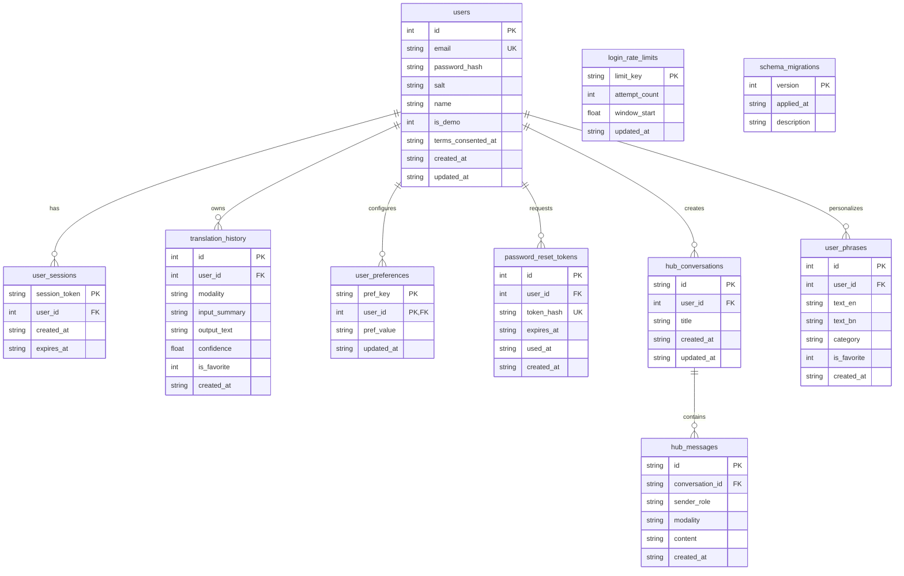

# Transify 2.0 — Database Architecture & Schema Specification

**Database Engine:** SQLite 3 (WAL Mode — Write-Ahead Logging)  
**Location:** `data/transify.db` (Configurable via `TRANSIFY_DB_PATH`)  
**Security Standard:** Zero Dynamic SQL Interpolation · 100% Parameterized Queries · Argon2id Hashing  
**Date:** November 19, 2026

---

## 1. Engine Configuration & Concurrency Architecture

Transify uses SQLite configured for high-concurrency production workloads:
1. **WAL Mode (`PRAGMA journal_mode=WAL;`):** Allows concurrent readers while a writer commits transactions.
2. **Busy Timeout (`PRAGMA busy_timeout=5000;`):** Waits up to 5000 ms on write contention before raising a busy error.
3. **Synchronous Normal (`PRAGMA synchronous=NORMAL;`):** Balances data durability with maximum I/O throughput.
4. **Foreign Key Enforcement (`PRAGMA foreign_keys=ON;`):** Enforces relational integrity across parent-child records.

---

## 2. Relational Schema & Table Definitions



---

## 3. Index Strategy (11 Production Indexes)

To prevent N+1 query slowdowns and guarantee instant lookups, the following explicit indexes are maintained:

```sql
CREATE INDEX IF NOT EXISTS idx_users_email ON users(email);
CREATE INDEX IF NOT EXISTS idx_sessions_token ON user_sessions(session_token);
CREATE INDEX IF NOT EXISTS idx_rate_limits_key ON login_rate_limits(limit_key);
CREATE INDEX IF NOT EXISTS idx_history_user_id ON translation_history(user_id);
CREATE INDEX IF NOT EXISTS idx_history_favorite ON translation_history(is_favorite);
CREATE INDEX IF NOT EXISTS idx_prefs_user_id ON user_preferences(user_id);
CREATE INDEX IF NOT EXISTS idx_reset_token_hash ON password_reset_tokens(token_hash);
CREATE INDEX IF NOT EXISTS idx_reset_user_id ON password_reset_tokens(user_id);
CREATE INDEX IF NOT EXISTS idx_hub_conv_user ON hub_conversations(user_id);
CREATE INDEX IF NOT EXISTS idx_hub_msg_conv ON hub_messages(conversation_id);
CREATE INDEX IF NOT EXISTS idx_user_phrases_user ON user_phrases(user_id);
```

---

## 4. Versioned Schema Migrations (Versions 1–7)

Migrations are tracked in `schema_migrations` and execute idempotently on server startup:

| Version | Description | Key Changes |
| :-: | :--- | :--- |
| **1** | Baseline Schema | Initial creation of users, sessions, history, and preferences. |
| **2** | Composite PK Preferences | Rebuilt `user_preferences` with composite primary key `(pref_key, user_id)`. |
| **3** | Argon2id & Rate Limits | Introduced persistent rate limiting table and Argon2id hash storage. |
| **4** | Communication Hub | Created `hub_conversations` and `hub_messages` tables. |
| **5** | Phraseboard System | Created `user_phrases` table for personal and custom expressions. |
| **6** | History Favoriting | Added `is_favorite` boolean column to `translation_history`. |
| **7** | Anti-Enumeration Tokens | Created `password_reset_tokens` with single-use hashes and 30-min bounded expiry. |

---

## 5. Disaster Recovery: Backup & Restore Protocol

Transify includes turnkey, non-blocking online backup and rollback scripts:

### Online Backup (`scripts/backup_db.py`)
```bash
python scripts/backup_db.py [source_db] [backup_dir]
```
- Uses `sqlite3.Connection.backup()` to transfer database pages in non-blocking batches.
- Runs `PRAGMA integrity_check` on the resulting snapshot before logging success.

### Online Rollback / Restore (`scripts/restore_db.py`)
```bash
python scripts/restore_db.py <backup_file> [target_db]
```
- Performs a pre-flight integrity check on the source backup.
- Restores pages to target database with zero downtime.
- Executes post-flight integrity verification.

