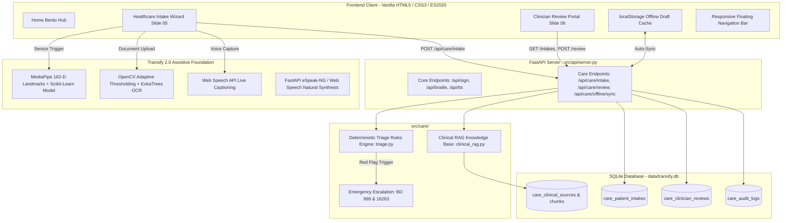

# Transify Care — Technical System Architecture
**System Version**: 2.5.0-care  
**Component Ecosystem**: FastAPI Backend + Pure Vanilla Frontend + SQLite + Deterministic Safety Rules + Clinical RAG

---

## 1. High-Level Architecture Diagram

---

## 2. Component Specifications

### 2.1 Backend Modules (`src/care/`)

| File | Purpose | Key Classes & Functions |
|---|---|---|
| `db_care.py` | Schema initialization, relational persistence, and audit logging. | `init_care_db()`, `create_intake()`, `get_intake()`, `list_intakes()`, `add_clinician_review()`, `log_care_audit()` |
| `triage.py` | Versioned, deterministic clinical decision rules and emergency escalation. | `evaluate_triage()`, `DETERMINISTIC_RULES`, `EMERGENCY_CONTACTS` |
| `clinical_rag.py` | Evidence indexing, keyword/semantic chunk matching, and citation assembly. | `seed_clinical_sources_if_empty()`, `search_clinical_evidence()` |
| `../api/care_routes.py` | FastAPI route handlers and Pydantic validation schemas. | `submit_patient_intake()`, `get_single_intake()`, `review_patient_intake()`, `sync_offline_drafts()`, `reset_competition_demo_fixtures()` |

### 2.2 Relational Data Model (`data/transify.db`)

1. **`care_patient_intakes`**:
   - `id`: INTEGER PRIMARY KEY AUTOINCREMENT
   - `patient_id`: TEXT NOT NULL
   - `input_modality`: TEXT NOT NULL (`sign`, `braille`, `voice`, `text`)
   - `raw_input`: TEXT
   - `confirmed_text`: TEXT NOT NULL
   - `chief_complaint`: TEXT NOT NULL
   - `symptom_description`: TEXT NOT NULL
   - `onset_duration`: TEXT
   - `trajectory`: TEXT (`improving`, `stable`, `worsening`)
   - `severity`: INTEGER (1 to 10)
   - `medical_context`: TEXT
   - `allergies_medications`: TEXT
   - `consent_granted`: INTEGER NOT NULL (0 or 1)
   - `status`: TEXT (`SUBMITTED`, `REVIEWED`, `ESCALATED`)
   - `urgency_level`: TEXT (`RED`, `YELLOW`, `GREEN`, `INSUFFICIENT_INFORMATION`)
   - `triage_explanation`: TEXT
   - `triage_rule_id`: TEXT
   - `evidence_citations`: JSON TEXT
   - `created_at`: TEXT ISO8601

2. **`care_clinical_sources` & `care_clinical_chunks`**:
   - Stores approved protocols from WHO, DGHS, and NINS.
   - Chunks indexed by condition, tags, severity flags, and verbatim protocol excerpts.

3. **`care_clinician_reviews`**:
   - `id`: INTEGER PRIMARY KEY AUTOINCREMENT
   - `intake_id`: INTEGER NOT NULL (Foreign Key)
   - `clinician_id`: TEXT NOT NULL
   - `clinician_name`: TEXT NOT NULL
   - `action`: TEXT (`ACCEPTED`, `MODIFIED`, `OVERRIDDEN`, `COMPLETED`)
   - `urgency_override`: TEXT (`NONE`, `RED`, `YELLOW`, `GREEN`)
   - `override_reason`: TEXT (Mandatory when urgency overridden)
   - `clinical_notes`: TEXT
   - `reviewed_at`: TEXT ISO8601

4. **`care_audit_logs`**:
   - Immutable audit trail recording event types, actors, roles, target IDs, and structured payloads.
