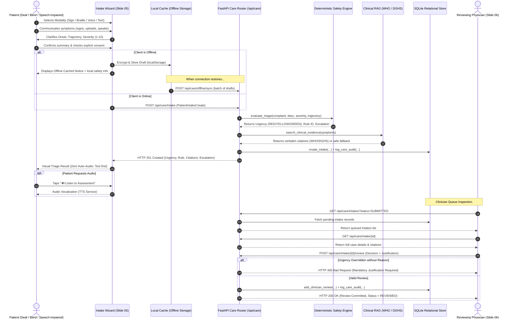

# Transify Care — End-to-End Data Flow Specification
**System Version**: 2.5.0-care

---

## 1. Sequence Diagram: Patient Intake to Clinician Sign-Off

---

## 2. Data Flow Validation Checks

1. **Consent Gate**: If `consent_granted == False`, the intake is rejected immediately with HTTP 400 before triage or RAG is called.
2. **Deterministic Triage Gate**: All inputs undergo rule-based pattern evaluation prior to persistence.
3. **Emergency Escalation Gate**: If RED urgency is triggered, the response payload must contain direct hotlines (`999`, `16263`).
4. **Override Governance Gate**: If `urgency_override != 'NONE'`, `override_reason` must be non-empty and minimum 5 characters, or the request fails.
5. **Audit Gate**: Every state mutation (`INTAKE_CREATED`, `CLINICIAN_REVIEW_RECORDED`, `OFFLINE_SYNC_COMPLETED`) writes a transaction-safe record to `care_audit_logs`.
