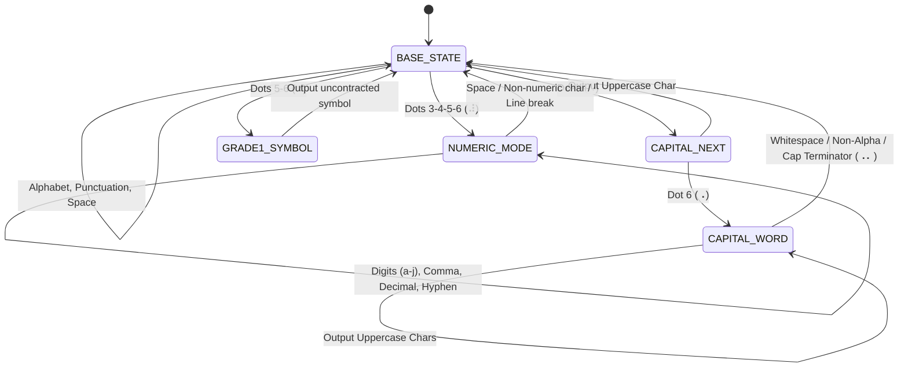

# Unified English Braille (UEB) Grade 1 Reference Manual
## Official Specification, Character Mappings, and State Machine Logic
**Standard Authority:** International Council on English Braille (ICEB)  
**Specification Reference:** The Rules of Unified English Braille, Third Edition (2024)  
**System Implementation Target:** Transify Module 02 (Braille AI Subsystem)

---

## 1. Introduction and Structural Principles

Unified English Braille (UEB) is an internationally standardized tactile writing code for the English language developed by the International Council on English Braille (ICEB). UEB is divided into:
1. **Grade 1 (Uncontracted Braille):** Direct character-by-character representation where words are spelled out letter-by-letter without contractions or shorthand abbreviations.
2. **Grade 2 (Contracted Braille):** Contains 180 contractions, word signs, and shortforms designed to increase reading speed and reduce document bulk.

Transify's primary initial scope is **UEB Grade 1**, which forms the unambiguous structural foundation for optical Braille character recognition, literacy evaluation, and document digitization.

### 1.1 The Six-Dot Matrix and Coordinate System
A standard Braille cell consists of a rectangular grid of six dot positions organized into two vertical columns of three dots each:

```
    Column 1      Column 2
    (Left)        (Right)
    
   (1)  •          •  (4)     <- Top Row
   (2)  •          •  (5)     <- Middle Row
   (3)  •          •  (6)     <- Bottom Row
```

Each dot position is numbered:
- **Dot 1:** Top-left
- **Dot 2:** Middle-left
- **Dot 3:** Bottom-left
- **Dot 4:** Top-right
- **Dot 5:** Middle-right
- **Dot 6:** Bottom-right

### 1.2 Binary Vector and Unicode Encoding
Every Braille cell is deterministically modeled as a 6-dimensional binary tuple:
$$\mathbf{d} = (d_1, d_2, d_3, d_4, d_5, d_6) \in \{0, 1\}^6$$
where $d_i = 1$ denotes an embossed (raised) dot, and $d_i = 0$ denotes an unembossed (flat) position.

The total number of discrete cell states is exactly $2^6 = 64$ configurations (ranging from an empty space cell $\mathbf{0}$ to a full 6-dot cell $\mathbf{1}$).

In standard Unicode (Block `U+2800` to `U+283F`), each cell is encoded using the standard bitmask formula:
$$\text{Codepoint}(\mathbf{d}) = 0\text{x}2800 + \sum_{i=1}^{6} d_i \cdot 2^{i-1}$$

| State | Dot Vector $(d_1, d_2, d_3, d_4, d_5, d_6)$ | Hex | Unicode Glyph | Meaning |
|---|---|---|:---:|---|
| Empty Space | $(0, 0, 0, 0, 0, 0)$ | `0x2800` | `⠀` | Word space / Blank cell |
| Dot 1 only | $(1, 0, 0, 0, 0, 0)$ | `0x2801` | `⠁` | Letter `a` / Digit `1` |
| Dots 1, 2 | $(1, 1, 0, 0, 0, 0)$ | `0x2803` | `⠃` | Letter `b` / Digit `2` |
| Full 6 dots | $(1, 1, 1, 1, 1, 1)$ | `0x283F` | `⠿` | Full cell (for alignment) |

---

## 2. UEB Grade 1 Alphabet Mappings (A–Z)

The 26 standard English alphabet letters are divided into three historical Decades defined by Louis Braille:

### Decade 1: Letters A through J (Upper Cell Dots 1, 2, 4, 5)
These ten core patterns use only the top four dot positions (Dots 1, 2, 4, 5). They form the base root configurations for the subsequent letters and digits.

| Letter | Active Dots | Dot Vector $(d_1, d_2, d_3, d_4, d_5, d_6)$ | Braille Glyph | Unicode | Hex Value |
|:---:|:---:|:---:|:---:|:---:|:---:|
| **a** | 1 | $(1, 0, 0, 0, 0, 0)$ | `⠁` | `U+2801` | `0x01` |
| **b** | 1-2 | $(1, 1, 0, 0, 0, 0)$ | `⠃` | `U+2803` | `0x03` |
| **c** | 1-4 | $(1, 0, 0, 1, 0, 0)$ | `⠉` | `U+2809` | `0x09` |
| **d** | 1-4-5 | $(1, 0, 0, 1, 1, 0)$ | `⠙` | `U+2819` | `0x19` |
| **e** | 1-5 | $(1, 0, 0, 0, 1, 0)$ | `⠑` | `U+2811` | `0x11` |
| **f** | 1-2-4 | $(1, 1, 0, 1, 0, 0)$ | `⠋` | `U+280B` | `0x0B` |
| **g** | 1-2-4-5 | $(1, 1, 0, 1, 1, 0)$ | `⠛` | `U+281B` | `0x1B` |
| **h** | 1-2-5 | $(1, 1, 0, 0, 1, 0)$ | `⠓` | `U+2813` | `0x13` |
| **i** | 2-4 | $(0, 1, 0, 1, 0, 0)$ | `⠊` | `U+280A` | `0x0A` |
| **j** | 2-4-5 | $(0, 1, 0, 1, 1, 0)$ | `⠚` | `U+281A` | `0x1A` |

### Decade 2: Letters K through T (Decade 1 + Dot 3)
Created by adding **Dot 3** to the corresponding Decade 1 pattern:

| Letter | Decade 1 Root | Active Dots | Dot Vector $(d_1, d_2, d_3, d_4, d_5, d_6)$ | Braille Glyph | Unicode | Hex Value |
|:---:|:---:|:---:|:---:|:---:|:---:|
| **k** | a | 1-3 | $(1, 0, 1, 0, 0, 0)$ | `⠅` | `U+2805` | `0x05` |
| **l** | b | 1-2-3 | $(1, 1, 1, 0, 0, 0)$ | `⠇` | `U+2807` | `0x07` |
| **m** | c | 1-3-4 | $(1, 0, 1, 1, 0, 0)$ | `⠍` | `U+280D` | `0x0D` |
| **n** | d | 1-3-4-5 | $(1, 0, 1, 1, 1, 0)$ | `⠝` | `U+281D` | `0x1D` |
| **o** | e | 1-3-5 | $(1, 0, 1, 0, 1, 0)$ | `⠕` | `U+2815` | `0x15` |
| **p** | f | 1-2-3-4 | $(1, 1, 1, 1, 0, 0)$ | `⠏` | `U+280F` | `0x0F` |
| **q** | g | 1-2-3-4-5 | $(1, 1, 1, 1, 1, 0)$ | `⠟` | `U+281F` | `0x1F` |
| **r** | h | 1-2-3-5 | $(1, 1, 1, 0, 1, 0)$ | `⠗` | `U+2817` | `0x17` |
| **s** | i | 2-3-4 | $(0, 1, 1, 1, 0, 0)$ | `⠎` | `U+280E` | `0x0E` |
| **t** | j | 2-3-4-5 | $(0, 1, 1, 1, 1, 0)$ | `⠞` | `U+281E` | `0x1E` |

### Decade 3: Letters U, V, X, Y, Z (Decade 1 + Dots 3, 6) & Letter W
Created by adding **Dots 3 and 6** to the Decade 1 root (Letter `w` was added later to English Braille as dots 2-4-5-6):

| Letter | Decade 1 Root | Active Dots | Dot Vector $(d_1, d_2, d_3, d_4, d_5, d_6)$ | Braille Glyph | Unicode | Hex Value |
|:---:|:---:|:---:|:---:|:---:|:---:|
| **u** | a | 1-3-6 | $(1, 0, 1, 0, 0, 1)$ | `⠥` | `U+2825` | `0x25` |
| **v** | b | 1-2-3-6 | $(1, 1, 1, 0, 0, 1)$ | `⠧` | `U+2827` | `0x27` |
| **w** | special | 2-4-5-6 | $(0, 1, 0, 1, 1, 1)$ | `⠺` | `U+283A` | `0x3A` |
| **x** | c | 1-3-4-6 | $(1, 0, 1, 1, 0, 1)$ | `⠭` | `U+282D` | `0x2D` |
| **y** | d | 1-3-4-5-6 | $(1, 0, 1, 1, 1, 1)$ | `⠽` | `U+283D` | `0x3D` |
| **z** | e | 1-3-5-6 | $(1, 0, 1, 0, 1, 1)$ | `⠵` | `U+2835` | `0x35` |

---

## 3. UEB Capital Indicators (ICEB Section 8)

UEB does not possess distinct upper-case dot patterns. Instead, capitalization is signaled via prefix modifier indicators using **Dot 6**:

| Indicator | Cells | Active Dots | Unicode Glyph | Meaning & Operational Scope |
|---|:---:|:---:|:---:|---|
| **Capital Letter Indicator** | 1 | 6 | `⠠` | Capitalizes the **single immediately following letter** (e.g. `⠠⠁` $\to$ `A`). |
| **Capital Word Indicator** | 2 | 6, 6 | `⠠⠠` | Capitalizes an **entire continuous word** (all following letters until whitespace, hyphen, or terminator, e.g. `⠠⠠⠓⠑⠇⠇⠕` $\to$ `HELLO`). |
| **Capital Passage Indicator** | 3 | 6, 6, 6 | `⠠⠠⠠` | Capitalizes an entire passage spanning multiple sentences or lines. |
| **Capital Terminator** | 2 | 6, 3 | `⠠⠄` | Terminates a capitalized word or passage early (e.g. `⠠⠠⠍⠉⠠⠄⠙⠕⠝⠁⠇⠙` $\to$ `McDONALD`). |

---

## 4. UEB Numeric Mode & Digits (ICEB Section 6)

In UEB, numeric digits are represented by Decade 1 letters (`a` through `j`) placed in **Numeric Mode**:

### 4.1 Numeric Indicator
- **Active Dots:** **3-4-5-6** (`⠼`, `U+283C`).
- **Effect:** Sets the state machine into `NUMERIC_MODE`. All subsequent Decade 1 letters are mapped to numbers `1` through `0`.
- **Termination:** Numeric mode is terminated by any blank cell (space), any letter that is not preceded by a numeric space, line breaks, or a Grade 1 indicator.

### 4.2 Digit Mappings under Numeric Mode
| Digit | Decade 1 Letter | Active Dots | Braille Glyph | Example in Numeric Mode | Output |
|:---:|:---:|:---:|:---:|:---:|:---:|
| **1** | a | 1 | `⠁` | `⠼⠁` | `1` |
| **2** | b | 1-2 | `⠃` | `⠼⠃` | `2` |
| **3** | c | 1-4 | `⠉` | `⠼⠉` | `3` |
| **4** | d | 1-4-5 | `⠙` | `⠼⠙` | `4` |
| **5** | e | 1-5 | `⠑` | `⠼⠑` | `5` |
| **6** | f | 1-2-4 | `⠋` | `⠼⠋` | `6` |
| **7** | g | 1-2-4-5 | `⠛` | `⠼⠛` | `7` |
| **8** | h | 1-2-5 | `⠓` | `⠼⠓` | `8` |
| **9** | i | 2-4 | `⠊` | `⠼⠊` | `9` |
| **0** | j | 2-4-5 | `⠚` | `⠼⠚` | `0` |

### 4.3 Numeric Punctuation within Numbers
UEB defines special numeric separators that maintain numeric mode without requiring re-triggering:
- **Comma (digit grouping separator):** Dot 2 (`⠂`, e.g. `⠼⠁⠂⠚⠚⠚` $\to$ `1,000`).
- **Decimal Point:** Dots 4-6, 2 or Dots 2-5-6 (`⠲`, e.g. `⠼⠉⠲4` $\to$ `3.14`).
- **Simple Fraction Line:** Dots 3-4 (`⠌`, e.g. `⠼⠉⠌4` $\to$ `3/4`).
- **Numeric Space:** Dot 5 (`⠐`) within long digit groupings.

---

## 5. UEB Punctuation Marks (ICEB Section 7)

Punctuation symbols are primarily formed using lower dots (Dots 2, 3, 5, 6):

| Punctuation Name | Symbol | Active Dots | Braille Glyph | Unicode | Notes |
|---|:---:|:---:|:---:|:---:|---|
| **Period (Full Stop)** | `.` | 2-5-6 | `⠲` | `U+2832` | Also used as decimal point in numbers |
| **Comma** | `,` | 2 | `⠂` | `U+2802` | Also used as thousands separator |
| **Semicolon** | `;` | 2-3 | `⠆` | `U+2806` | |
| **Colon** | `:` | 2-5 | `⠒` | `U+2812` | |
| **Question Mark** | `?` | 2-3-6 | `⠦` | `U+2826` | Identical dot configuration to open quote |
| **Exclamation Mark** | `!` | 2-3-5 | `⠖` | `U+2816` | |
| **Hyphen / Minus** | `-` | 3-6 | `⠤` | `U+2824` | Does NOT cancel numeric mode |
| **Apostrophe / Single Quote**| `'` | 3 | `⠄` | `U+2804` | Used in contractions (e.g. `it's`) |
| **Open Double Quotation** | `“` | 2-3-6 | `⠦` | `U+2826` | When preceded by whitespace or start of line |
| **Close Double Quotation**| `”` | 3-5-6 | `⠴` | `U+2834` | When following text |
| **Slash (Solidus)** | `/` | 4-5-6, 3-4 | `⠸⠌` | `U+2838 U+280C` | Compound 2-cell symbol |

---

## 6. UEB Grade 1 Mode Indicators (ICEB Section 5)

When a letter or symbol could be ambiguously misinterpreted as a contraction or digit, Grade 1 Mode is explicitly invoked:
- **Grade 1 Symbol Indicator:** Dots 5-6 (`⠰`, `U+2830`) — forces the single following cell into Grade 1 interpretation.
- **Grade 1 Word Indicator:** Dots 5-6, 5-6 (`⠰⠰`) — forces the entire word into Grade 1.
- **Grade 1 Passage Indicator:** Dots 5-6, 5-6, 5-6 (`⠰⠰⠰`) — forces a multi-word passage into Grade 1.
- **Grade 1 Terminator:** Dots 5-6, 3 (`⠰⠄`) — terminates a Grade 1 word or passage.

---

## 7. Out-of-Scope Grade 2 Detection & Honest Reporting

Grade 2 Braille includes 180 contractions and shortforms. Transify does NOT silently misdecode Grade 2 cells as Grade 1. 

The decoder includes an **Out-of-Scope Grade 2 Contraction Detector** that flags common contracted indicators:
1. **Strong Wordsigns:** Standalone single-letter wordsigns (e.g. `⠃` standalone = `but`, `⠉` = `can`, `⠙` = `do`, `⠽` = `you`).
2. **Strong Contractions:** Dots 1-2-3-4-6 (`⠯` = `and`), Dots 1-2-3-4-5-6 (`⠿` = `for`), Dots 1-2-3-5-6 (`⠷` = `of`), Dots 2-3-4-6 (`⠮` = `the`), Dots 2-3-4-5-6 (`⠾` = `with`).
3. **Composite Prefixes:** Prefixes using Dot 4, Dot 5, Dots 4-5, Dots 4-5-6 preceding a letter cell.

When these patterns occur outside Grade 1 indicators, the decoder flags an informational alert:
> `[NOTICE: Possible Grade 2 Contraction Detected at Cell Index N. Uncontracted Grade 1 decoding applied.]`

---

## 8. Deterministic UEB Grade 1 State Machine Flowchart



This specification forms the mathematical and operational contract for Transify's UEB Grade 1 decoder implementation.
